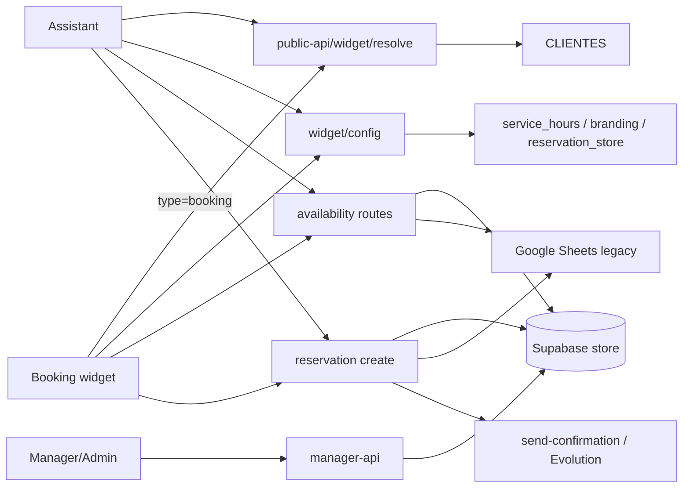

# Arquitectura COSTABOTS Hospitality

## Recorrido principal

Assistant y Booking resuelven un tenant mediante `GET /public-api/widget/resolve?slug=...`. Sin `type` se usa `assistant_slug`; con `type=booking` se usa `booking_slug`. La respuesta pública contiene `ok`, `client_id` y `public_token`.

Después consumen `GET /public-api/widget/config` con esas credenciales. Disponibilidad de restaurante usa `POST /public-api/availability/by-day` y `/by-hour`. Balinesa usa `/reservation/balinese/availability`.

Creación estándar: `/reservation/create`; creación Balinesa: `/reservation/balinese/create`. Tras crear, la confirmación se solicita mediante `/reservation/send-confirmation`.

## Diagrama de dependencias

Módulos fuente principales: `supabase/functions/public-api/index.ts`, `routes/widgetResolve.ts`, `routes/widgetConfig.ts`, `routes/availabilityByDay.ts`, `routes/availabilityByHour.ts`, `routes/reservationCreate.ts`, `routes/reservationBalineseAvailability.ts`, `routes/reservationBalineseCreate.ts` y `routes/reservationSendConfirmation.ts`. Assistant usa `src/api/publicApiClient.ts` y sus flows de mesa; Booking usa `costabots-booking/src/api/publicApiClient.ts` y `src/components/StepOneAvailability.tsx`/`BookingWidget.tsx`.

## Capas

- Frontends: Assistant, Booking y Manager/Admin.
- Edge Functions: `public-api` para contratos públicos y `manager-api` para operaciones autenticadas/operativas.
- Persistencia: tablas Supabase nuevas y, en rutas legacy, Google Sheets según `reservation_store`.
- Integraciones: Google Sheets y Evolution/WhatsApp. Credenciales nunca deben documentarse aquí.

## Separación

AURA/Beauty (`aura-source`) y cualquier Typebot/flujo legacy deben tratarse como sistemas separados hasta verificar repositorio, proyecto y contrato.

## Resumen ejecutivo

El riesgo principal actual es la divergencia entre el código autorizado y la versión desplegada de una Edge Function. La recuperación debe empezar por identidad de origen y versión, no por cambios en frontends. La arquitectura Hospitality funciona de nuevo tras restaurar el guard legacy y publicar `public-api` desde MANAGER.

## Hecho frente a pendiente

Confirmado por código: rutas, módulos y separación `assistant_slug`/`booking_slug`. Pendiente: Typebot, Experience, Vercel y configuración completa de WhatsApp; no se deben inferir a partir de nombres de dominio.
