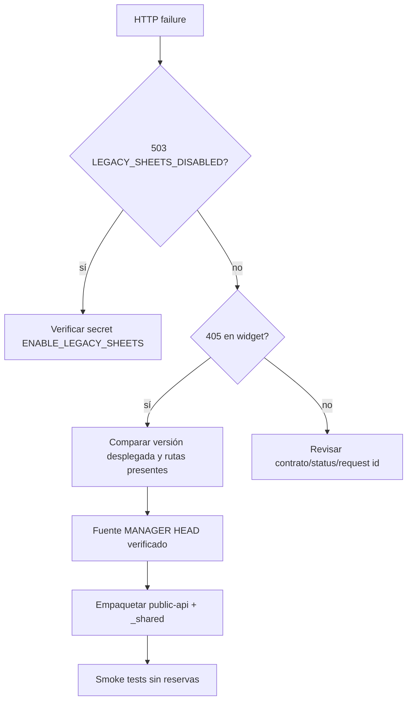

# Recuperación reversible

1. Congelar cambios y capturar síntomas, URL, código HTTP y request id.
2. Identificar la versión desplegada de la función y compararla con el commit autorizado.
3. Restaurar variables necesarias solo con aprobación explícita; no imprimir valores.
4. Desplegar únicamente la función afectada desde un commit verificado.
5. Probar `widget/resolve` Assistant y Booking, config, disponibilidad y una ruta no destructiva.
6. Si falla, volver a la versión anterior conocida mediante el mecanismo de Supabase y registrar la decisión.

Nunca crear reservas reales durante recovery. `ENABLE_LEGACY_SHEETS=true` reabre rutas legacy; debe mantenerse solo mientras ese store sea operativo y documentado.

## Árbol de diagnóstico

Comandos verificados en esta auditoría: `npx supabase functions list --project-ref tbmkbzpdixoeucvvofjp`, `npx supabase secrets list --project-ref ...` y `npx supabase functions deploy public-api --project-ref ... --workdir <paquete> --no-verify-jwt`. Los secretos y sus valores nunca se imprimen. Aliases Vercel y DNS no tienen procedimiento verificado y quedan PENDIENTE.
